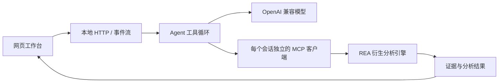

# REA 拆解助手

在网页中与 Agent 对话，拆解本地软件、追踪实现逻辑、查看分析证据。

**基于 REA（Reverse Engineer Anything）逆向工程能力构建的独立开源产品。** 把软件分析、Agent 对话和证据查看放进一个网页工作台：输入本地目标路径，提出问题，跟随分析过程查看结果。

由本项目维护网页交互与 Agent 调度层，分析能力沿用开源引擎。完整代码来源及贡献说明见[致谢与来源](ACKNOWLEDGEMENTS.md)。**当前为 0.1 MVP，面向个人本机使用。**

## 现在能做什么

- 浏览器聊天、新建分析、连续追问、历史会话恢复。
- 连接带 tool calling 的 OpenAI 兼容模型服务。
- Agent 按问题检索工具，通过真实 MCP 连接进行静态分析。
- 工具执行进度、原始证据展开查看、会话和证据 JSON 导出。
- 默认关闭目标执行、设备修改、网络操作及目标修改工具。

REA 拆解助手专注软件逆向分析：由模型选择工具、追踪线索，再结合证据解释软件的结构与逻辑。

## 本地启动

推荐 Apple Silicon Mac、Node.js 24（引擎工具链见 `.nvmrc`）。首次安装和启动需要终端，之后对话与结果查看都在网页进行。

```bash
npm ci
npm run build:cached
npm run web
```

打开 **http://127.0.0.1:8790**，点击「模型设置」，填写 API 基础地址（通常以 `/v1` 结尾）、模型 ID 和 API Key。

模型必须支持 OpenAI Chat Completions 工具调用。密钥仅在当前服务内存中保留，重启后需要重新填写。也可设置 `REA_API_BASE`、`REA_MODEL`、`REA_API_KEY` 环境变量；不要提交密钥。

例子：

> 分析 `/绝对路径/我的应用.app`，告诉我它的技术栈，并引用你找到的证据。

> 打开 `/绝对路径/game.js`，查找计分逻辑，区分已确认的事实和推测。

分析目标需要位于运行服务的电脑上。部分格式需要自行安装 Ghidra、JADX 等工具；界面不能替代这些底层依赖。

## 架构



- `web/public/`：原生 HTML / CSS / JS，聊天与证据面板。
- `web/server.mjs`：本地 HTTP 服务、模型配置、工具发现、权限过滤、会话持久化。
- `src/`、`bridge/`：上游分析引擎及适配器。
- `.rea-web/`：本地聊天和证据，已被 Git 忽略。

网页只监听 `127.0.0.1`，校验 Host / Origin 和同源请求标识；这是单用户本地应用，**不要反向代理为公开服务**。会话明文保存在本机。分析结果及相关源码片段会发送给用户配置的模型服务。静态分析允许引擎启动其分析器或创建临时文件，并不表示完全不产生文件系统副作用。

底层引擎的扩展用法见 [Agent 接入说明](docs/installation.md#supported-agents)和[完整工具目录](docs/mcp-contracts.md#generated-catalog)。这些是引擎参考文档，网页首版开放范围以本页说明为准。

## 开发与验证

```bash
npm run web:test       # HTTP 边界、真实 MCP 样例、模拟模型工具循环与持久化
npm run check:fast     # 上游类型与规范检查
```

集成测试使用模拟模型与真实本地 MCP 引擎，不能替代真实模型服务验收。首次运行测试前需要完成引擎构建。未设置模型密钥时，网页不会伪造分析回答。

## 依赖审计

继承的锁文件在本次 `npm audit` 中报告 9 项依赖告警（7 中危、2 高危，包括 Zod 与文档站 Vite）。本次未批量升级分析引擎依赖；依赖修复和完整兼容性回归仍待完成，因此此版本仅作为本地 MVP，不作为公开托管服务发布。

## 当前边界

- 模型回答按完成的消息展示；工具进度实时推送，暂不逐 token 输出。
- 每轮最多 16 步；最多 8 个活跃 MCP 会话，重启服务释放引擎资源。
- 历史消息与原始工具结果持久化，分析器会话在服务重启后重新创建。
- 当前支持纯文本回答和原始 JSON 证据；尚未提供结构化报告排版、图谱或桌面安装包。
- 工具范围基于上游效果元数据过滤；未声称覆盖上游全部工具或所有外部分析器。

## 开源与致谢

本项目采用 [MIT 许可证](LICENSE)。REA 拆解助手的产品层由本项目维护，分析引擎来自 REA 及其衍生项目；完整继承关系、版本记录和新增工作见[致谢与来源](ACKNOWLEDGEMENTS.md)。第三方组件声明见 [THIRD_PARTY_NOTICES.md](THIRD_PARTY_NOTICES.md) 和 `licenses/`。

仅分析自己拥有或获得授权的软件。其他约束见 [DISCLAIMER.md](DISCLAIMER.md)。
